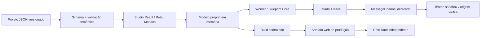

# Arquitetura v0.1 — BTRK Forge

## Recomendação

Tauri 2 + Rust no host Windows, React/TypeScript na interface, Rete 2 como adaptador de apresentação, Zod na fronteira do modelo, executor TypeScript determinístico e preview sem acesso nativo. Esta recomendação está apoiada por builds Windows e testes de navegador e WebView2. Electron permanece alternativa documental, sem benchmark ou protótipo executado.

## Fonte de verdade e IDs

`packages/project-schema` representa identidade/SemVer, versão de esquema, uma tela com botão, propriedades visuais, variáveis tipadas, grafo, conexões, posições e metadados de distribuição/permissões. Arrays de funções, recursos e dependências existem com validação restritiva e capacidade zero: sua execução ainda não é suportada. Estilos estão limitados à cor do botão; não há layout arbitrário. Não há interpretação de objetos internos do Rete no runtime.

IDs são strings estáveis, únicas globalmente dentro do projeto, com até 80 caracteres. Novos nodes recebem prefixo + UUID; importar, exportar e migrar preservam IDs. Conexões criadas no Rete recebem ID de domínio prefixado. Referências usam IDs, nunca índice, label ou endereço de memória.

## Tipagem e execução

Portas distintas `exec`, `number`, `boolean`, `string`. Compatibilidade exata, nenhuma coerção entre sockets; leitura de portas verifica propriedades próprias, evitando nomes herdados de Object.prototype. Variáveis exigem valor inicial compatível. Um único evento `button.click`, constantes, leitura de variável, soma, comparação, condição e atribuição formam a PoC. A saída da execução é estado novo e trace dos nodes de controle.

Entradas são obrigatórias, uma conexão por entrada e uma por saída de controle. Saída de dados admite múltiplos consumidores. Validação rejeita IDs repetidos, referências ausentes, sockets desconhecidos, tipos incompatíveis, ciclos de dados e controle, números não finitos e tamanhos excessivos. Todos os ciclos são proibidos nesta fase; loops futuros exigem semântica e orçamento explícitos.

Limites: JSON até 2 MB nas fronteiras textuais, 200 nodes, 500 conexões, 100 variáveis, 10.000 operações por evento e watchdog de 2 segundos no Studio. Rascunhos incompletos podem ser editados e recuperados; execução e importação explícita exigem validação semântica completa. Memória/tempo não foram submetidos a testes de carga máximos.

## Migração e compatibilidade

`schemaVersion=1`. Migração demonstrativa v0→v1 atua sobre cópia, adiciona `functions` vazio e preserva IDs. Versão futura é recusada; não há downgrade ou migração implícita destrutiva. Fase 1 deve criar fixtures históricas, backup transacional, validação pós-migração e recuperação se houver falha. SemVer do projeto, do esquema, do SDK, do Studio e do aplicativo são conceitos independentes.

## Persistência

JSON legível é a fonte portável/versionável. Download de arquivo e seleção explícita do usuário; nenhum comando de filesystem foi exposto ao frontend. O rascunho usa localStorage do perfil do WebView/navegador. Recuperação cobre reload e edição incompleta, não durabilidade transacional, concorrência ou corrupção de disco. Falha na leitura preserva o conteúdo original no storage e abre exemplo em memória com aviso; gravação fica bloqueada até abrir/aplicar um JSON válido ou restaurar explicitamente o exemplo. O arquivo JSON salvo é o backup recomendado nesta PoC.

SQLite foi avaliado como futuro índice/cache de busca, histórico e catálogo local. Não foi instalado nem testado. Não é uma segunda fonte de verdade. Persistência nativa atômica (temporário + flush + rename, backup anterior, detecção de conflitos) é gate da Fase 1.

## Isolamento e processos

Iframe `sandbox="allow-scripts"`, sem `allow-same-origin`, navegação, formulários ou permissões nativas. HTML/script são fixos; valores do projeto entram por `textContent`/propriedades limitadas. Canal `MessageChannel` transfere apenas renderização e evento conhecido; inicialização verifica `event.source===parent`. O `*` é necessário para a origem opaca; a referência do frame e o port dedicado delimitam a comunicação.

CSP do frame bloqueia rede, imagens e recursos externos. CSP do Studio permite script local e hash do script estático do frame, sem eval. Alterar esse script exige `npm run sync:csp`. O teste de produção aplica a CSP do host; Tauri também foi verificado visualmente. Styles inline existem por exigência do renderizador e das propriedades visuais limitadas.

O runtime roda em Web Worker separado do DOM. Um Worker não equivale a processo de sistema nem sandbox para código arbitrário: somente o interpretador fechado pode executar. Credenciais e acesso nativo não estão disponíveis.

O experimento de helper usa processo Node separado e IPC, executável e operação fixos, JSON validado, ambiente reduzido, prazo e encerramento pelo broker. Está fora do Studio. Não é isolamento de filesystem/rede no nível do SO; não recebe código de plugins ou IA. Execução genérica de builds/plugins permanece desabilitada. Antes de habilitá-la: broker Rust, workspace dedicado, allowlist de ferramentas, limites de saída/recursos, Job Objects/restricted token e proteção contra junctions/symlinks, com testes adversariais.

## Exportação

`export:web` valida o exemplo controlado e deriva HTML/TypeScript/CSS e JSON para bundle Vite de produção. O mesmo Blueprint Core interpreta o modelo incorporado. Não é compilação otimizada de cada node nem exportador geral de projetos. Servidor estático independente prova execução sem o Studio e sem Vite.

Um host Tauri próprio incorpora o mesmo artefato web, tem identificador/versão e pacote NSIS separados. `devUrl` só existe no Studio em desenvolvimento; produção usa `frontendDist` embutido. Sem acesso nativo no aplicativo gerado. Publicação, Authenticode, atualização assinada e instalação em máquina limpa não foram realizadas.

## Extensibilidade, IA e atualizações

Contratos TypeScript em `packages/forge-core/contracts.ts`; estratégia completa em [segurança e integrações](architecture/SEGURANCA_E_INTEGRACOES.md). Não há implementações ativas de provedor, SDK executável, credenciais ou updater. Monaco edita o modelo JSON com aplicação validada; round trip entre código JavaScript livre e grafo não faz parte da PoC.
