# Arquitetura v0.2 — persistência nativa (Fase 1A)

Complementa e preserva a [arquitetura da Fase 0](ARQUITETURA_V0_1.md). Tauri/Rust, React/TypeScript, Rete, Monaco e Blueprint Core continuam. Não há nuvem, autenticação, execução arbitrária, IA ou SDK de plugins habilitados.

## Fluxo implementado

```mermaid
flowchart LR
  UI[Modelo próprio / estado de edição] --> Client[Cliente IPC tipado]
  Client --> ACL[ACL Tauri / janela local main]
  ACL --> Picker[Diálogo nativo / seleção de pasta ou manifesto]
  Picker --> Session[Sessão opaca / diretório autorizado]
  Session --> Validate[JSON Schema + validação semântica Rust]
  Validate --> Temp[Temporário exclusivo / sync_all / revalidação]
  Temp --> Swap[Troca Windows / hash do arquivo substituído]
  Swap --> Verify[Verificação do manifesto / backup válido]
  Verify --> Receipt[Documento e revisão confirmados]
  Receipt --> UI
```

`packages/native-persistence` é uma biblioteca Rust independente do Tauri. O host em `apps/studio/src-tauri/src/projects.rs` cuida de diálogos, registro de sessões e IPC. `use-projects.tsx` coordena operações, indicador de alterações, estados ocupados, conflito, confirmação e fechamento. Dados de execução continuam separados da definição persistente.

## Autorização de arquivos

O frontend não envia caminhos absolutos ou relativos para operações de disco. Novo/Salvar como enviam nome de pasta validado e documento JSON; o backend abre um seletor de pasta e cria uma pasta nova, sem sobrescrever destinos existentes. Abrir usa seletor nativo de manifesto. Demais operações recebem somente token opaco de sessão criado pelo backend. Localização retornada serve à apresentação, sem conferir autoridade a novas chamadas.

Comandos registrados em `AppManifest::commands` e autorizados explicitamente pela capability `project-workspace`, somente para janela local `main`: create, open, save, save_as, reload, restore, close e exit. Eventos listen/unlisten permitem o fluxo de fechamento. Não há permissões genéricas de filesystem/shell/HTTP, domínios remotos, glob de janelas ou bridge global pública. `check:security` confere a lista exata e o vínculo de comandos à ACL. [Mecanismo oficial de capabilities do Tauri](https://v2.tauri.app/security/capabilities/).

O diretório autorizado exige caminho absoluto em unidade local reconhecida pelo Windows; UNC, rede mapeada, dispositivo e traversal são recusados. Cada ancestral é aberto com handle que impede renomeação/deleção e com OPEN_REPARSE_POINT; os atributos do handle recusam reparse points. Arquivos gerenciados são abertos sem seguir reparse points e recusam hard links. Nomes gerados pelo serviço são fixos ou UUID; nada no projeto escolhe arquivos, executáveis ou argumentos. Plataformas diferentes de Windows falham fechadas.

Um lock exclusivo de arquivo impede duas instâncias do serviço sobre a mesma pasta. Ele não impede editores externos que não participem do protocolo. Ler arquivos usa limites e checagem de objeto regular; permissões, somente leitura e erros de disco geram erro localizado sem descartar o conteúdo de edição. Isso não é sandbox contra um administrador ou processo com a mesma autoridade capaz de manipular o disco; a janela de corrida de escritores externos é tratada abaixo.

## Escrita e backup

1. Validar JSON, schema, IDs, tipos e referências; preservar identidade da sessão.
2. Comparar SHA-256 dos bytes atuais com a revisão aberta, incluindo ausência do arquivo.
3. Criar temporário com UUID exclusivo no mesmo diretório/volume; escrever, chamar `sync_all`, fechar e reabrir para validação.
4. Comparar novamente o manifesto imediatamente antes da troca.
5. Para arquivo existente, usar `ReplaceFileW` com snapshot anterior de nome exclusivo. Para primeira gravação, usar `MoveFileExW` com WRITE_THROUGH e sem REPLACE_EXISTING, de modo que um destino criado por outro processo cause erro.
6. Verificar os bytes efetivamente substituídos contra o hash esperado, e verificar tamanho/hash/schema do novo manifesto.
7. Promover somente o snapshot anterior válido ao backup fixo, por troca no mesmo volume. Em restauração, manter o backup íntegro e preservar os bytes deslocados com outro UUID.
8. Atualizar revisão/documento da sessão e retirar o indicador de alterações somente após o recibo de sucesso.

Não se alega uma transação única envolvendo manifesto e backup. Interrupções entre passos podem deixar um manifesto completo e snapshots pendentes. Se uma chamada de substituição falhar com resultado potencialmente parcial, retornar `commit_uncertain`, preservar temporários e exigir conferência/recarga; se a troca ocorreu mas uma etapa posterior falhou, `committed=true` sinaliza que o disco pode já conter a nova versão. A UI mantém alterações em memória e oferece recarregar, salvar cópia ou cancelar.

[ReplaceFileW pode retornar estados parciais de falha e seu flag WRITE_THROUGH não é suportado](https://learn.microsoft.com/en-us/windows/win32/api/winbase/nf-winbase-replacefilew). Por isso o serviço não faz fallback destrutivo de apagar o principal e renomear depois. [MoveFileExW](https://learn.microsoft.com/en-us/windows/win32/api/winbase/nf-winbase-movefileexw) é usado sem COPY_ALLOWED, evitando simulação de cópia entre volumes.

## Garantias e limites reais

Testes reais executados no Windows x64/NTFS do ambiente, com arquivos, ACL, junction e hard link. Nesses testes, falhas injetadas deixaram a versão antiga ou uma nova versão completa, com recuperação de backup/temporário validado. Injeção controlada não reproduz queda de energia ou falha física de disco.

`sync_all` solicita sincronização dos bytes; controladora, caches, filesystem e falha de energia continuam relevantes. Não há fsync de diretório portável nem garantia universal para FAT/exFAT/ReFS, discos removíveis ou hardware defeituoso; somente a unidade local do ambiente foi efetivamente exercitada. APIs não suportadas falham e preservam os dados de edição. Instalação em máquina limpa continua pendente.

Conflito já existente na abertura/salvamento é detectado antes da escrita e não sobrescreve o disco. **Hash + troca não é compare-and-swap do kernel.** Um escritor externo pode alterar o arquivo entre a última comparação e ReplaceFileW. O serviço então detecta divergência dos bytes realmente substituídos, retorna conflito com `committed=true`, mantém o backup anterior e preserva os bytes externos no snapshot órfão. O principal pode já conter a proposta do Studio nessa corrida estreita; não há promessa de ausência de qualquer sobrescrita transitória. Esse cenário foi injetado em teste específico e não retorna sucesso silencioso. Bloqueio cooperativo com outros programas ou transação de SO exigiria outra estratégia.

## Recuperação e interface

Abrir principal inválido/ausente com cópia válida carrega candidato apenas em memória e bloqueia Salvar até restauração explícita ou Salvar como. Restaurar verifica manifesto e backup novamente, pede confirmação e não promove corrupção ao último backup. Schema/documentVersion futuro é rejeitado mesmo havendo backup, sem downgrade automático. Importações inválidas não substituem projeto atual.

Novo, Abrir, Salvar, Salvar como e Fechar projeto são ações reais. Cancelar diálogo preserva a sessão anterior. Troca/fechamento de projeto e fechamento da janela consultam alterações pendentes; Salvar e continuar só prossegue após sucesso. Enquanto houver operação de disco, a edição e as ações concorrentes ficam bloqueadas. Edição JSON não aplicada também mantém o indicador e exige aplicar/reverter antes de sair da aba; salvar valida esse rascunho.

O navegador mantém o laboratório/exportação JSON da Fase 0; somente o Studio nativo oferece acesso a projetos no disco. O driver de testes substitui diálogos em build Vite mode=test e executa a biblioteca Rust real em processo separado; esse driver não é registrado no Tauri ou distribuído no Studio.
