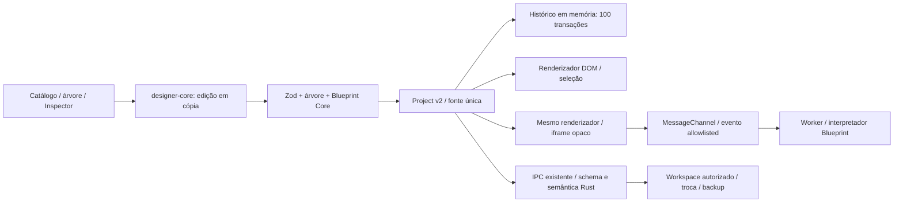

# Arquitetura v0.3 — Visual Designer

> Documento histórico da Fase 1B. O contrato corrente está no [formato v3](FORMATO_PROJETO_V3.md), [Blueprint Engine](BLUEPRINT_ENGINE.md) e [limites 1C](LIMITACOES_FASE_01C.md); esta fase histórica permanece preservada.

Mantém a [persistência v0.2](ARQUITETURA_V0_2.md). Não introduz novos comandos IPC, plugins, permissões nativas ou dependências de terceiros.

`packages/project-schema/components.ts` contém os contratos tipados. `packages/designer-core` implementa add/update/move/duplicate/remove e histórico; operações inválidas não modificam o original. A validação estrutural e semântica também existe no backend para documentos vindos de disco/IPC. A lista parentId ordenada representa a árvore sem manter relações redundantes.

`Designer.tsx` apresenta quatro regiões: catálogo, hierarquia, canvas e Inspector. Seleção/viewport são estado efêmero; o documento Project é a única fonte da interface salva. O Rete continua independente e reconstrói o grafo ao desfazer/refazer. Salvar recebe o mesmo documento, mantendo dirty, conflitos, cópias e recuperação da Fase 1A.

`visual-renderer.ts` é uma função DOM autocontida com tags e propriedades fixas. O Design chama essa função; o Preview embute uma versão gerada pelo TypeScript em `visual-renderer-source.ts`. Um teste confere a equivalência da geração. Isso evita depender de function.toString transformada de maneira diferente em desenvolvimento e produção. Não há eval ou compilação de texto fornecido pelo projeto.

Após alterar o renderizador, executar `npm run renderer:generate` e `npm run sync:csp`. O hash CSP cobre o script fixo do iframe; o teste de produção exercita o bundle com a CSP do host. Texto do projeto chega somente por MessageChannel e é renderizado como texto, nunca HTML. Estilos são allowlisted pelo schema. O frame mantém sandbox allow-scripts, origem opaca e nenhuma bridge nativa; o Worker continua interpretando somente o grafo declarativo.

A exportação da Fase 0 permanece uma ferramenta do exemplo controlado. Ela lê o Button v2 do exemplo para continuar funcionando; não passa a ser exportador generalizado do Designer. A Fase 1C não foi iniciada.
