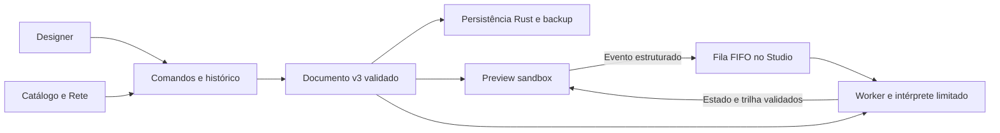

# Arquitetura v0.4 — Blueprint Engine

Complementa a arquitetura v0.3 sem ampliar capacidades nativas. Fase 1C: branch codex/phase-01c-blueprint-engine, base aprovada 175036e819a6b1aecccf88af8c6b9b4a34b07330. A main permanece preservada até revisão específica.

project-schema define v3/migrações; designer-core valida árvore e histórico; blueprint-core/edit aplica comandos de grafo; blueprint-core/runtime interpreta contratos declarativos; use-runtime coordena fila, Worker, timeout e sessão; Preview sobrepõe propriedades transitórias em uma cópia para renderizar. Nenhum objeto Rete, trace ou runtime é salvo no documento.

Renderizador compartilhado entre Design e iframe; fonte fixa gerada e CSP sincronizada. O canal Preview não possui comandos nativos; o broker de persistência continua restrito à janela main e ao workspace escolhido. Não foram adicionadas dependências ou permissões.

Os detalhes normativos de execução, limites, eventos e referências estão em [BLUEPRINT_ENGINE](BLUEPRINT_ENGINE.md). O [formato v3](FORMATO_PROJETO_V3.md) é corrente; v1/v2 permanecem históricos. [Limitações](LIMITACOES_FASE_01C.md) e cinco ressalvas herdadas continuam abertas. A geração TypeScript fiel foi investigada e adiada para integração de código; não há compilador/exportador geral nem promessa de round trip.
