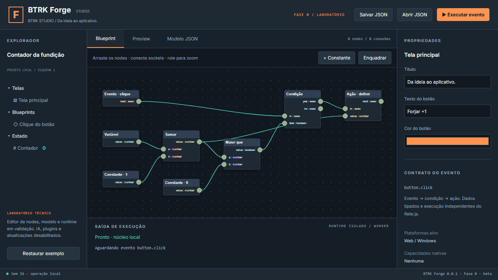
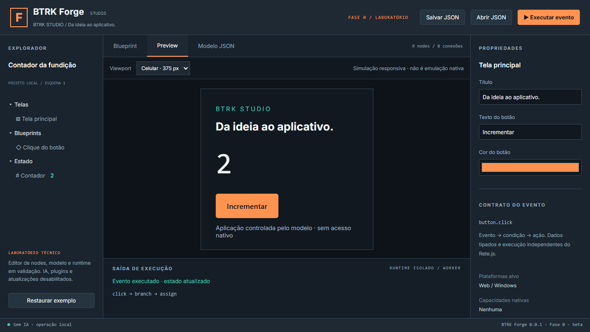

# Validação da Fase 0

Execução em 26/10/2026 no Windows x64 com MSVC e WebView2. Objetivo: verificar viabilidade da arquitetura, sem atribuir maturidade de produção ao protótipo.

Revalidação de encerramento: typecheck, lint, 19 testes de núcleo/integração, 4 de interface, 2 de produção, ambos os builds Windows e checks Rust aprovados novamente sobre o commit `8abf170901bf742d954e429b2bfcc4742ee52f4c`. Auditoria npm sem alertas e scanner de segredos/permissões sem achados. Nenhuma pendência abaixo foi considerada resolvida por essa repetição. Ver [registro oficial](../phases/ENCERRAMENTO_FASE_00.md).

## Matriz executada

| Procedimento | Resultado observado | Evidência reproduzível |
|---|---|---|
| TypeScript | Aprovado, sem erros | `npm run typecheck` |
| ESLint | Aprovado, sem erros | `npm run lint` |
| Núcleo/schema | 18 casos aprovados | `tests/blueprint.test.ts`, `npm test` |
| Helper em processo separado | 1 caso aprovado, aceita projeto e recusa mensagem de comando | `tests/helper.test.ts` |
| UI Rete/preview/persistência | 4 casos aprovados | `npm run test:e2e`, `artifacts/e2e-results.json` |
| Produção web/CSP/offline | 2 casos aprovados | `npm run test:production`, `artifacts/production-results.json` |
| Studio web e exportação | Aprovados, bundle gerado | `npm run build`, `npm run export:web` |
| Studio e app Windows/NSIS | Aprovados, dois executáveis e dois instaladores | `npm run desktop:build`, `npm run export:windows` |
| Hosts Rust | Compilação/test runner aprovados; zero testes Rust escritos | `cargo test --manifest-path <host>/Cargo.toml --locked` |
| Formatação Rust | Aprovada nos dois hosts | `cargo fmt --manifest-path <host>/Cargo.toml -- --check` |
| Auditoria npm | Zero vulnerabilidades reportadas | `npm audit --json`, `artifacts/npm-audit.json` |
| Segredos e permissões estáticas | Nenhum achado no escopo do scanner | `npm run check:security`, `artifacts/security-check.json` |
| Smoke Windows Studio | Abriu, grafo renderizado, preview mostrou 0 e depois 1, trace correto, janela fechou | Observação WebView2 por skill Computer Use nesta sessão |
| Smoke Windows app exportado | Abriu com Studio fechado, incrementou 0→1, fechou | Observação WebView2 por skill Computer Use nesta sessão |

Hosts: `apps/studio/src-tauri` e `tools/feasibility/windows`. Scripts no README. Artefatos locais não são publicados como releases; hashes e resumo em [evidências](evidence/RESUMO.json).

## Cobertura funcional

Unitários cobrem evento/operação/condição/ação, ramo falso, reexecução com estado, tipos number/string/boolean, serialização/IDs/posições, migração copiada, esquema futuro, JSON inválido/excessivo, referências de nodes/variáveis, sockets desconhecidos/incompatíveis/herdados, ciclos de controle/dados, IDs duplicados, entradas obrigatórias/múltiplas, tipo inicial/estado, overflow, conexão incremental, permissões proibidas, propriedades desconhecidas, limite de nodes/eventos e orçamento de DAG com custo exponencial.

Navegador cobre criação de constante; alteração de texto; reload com estado do projeto; preview/evento/contagem; viewport de celular; negação de parent.document e storage no frame; ausência de bridge Tauri; download/importação; rejeição sem substituição do modelo; Monaco; arraste com posição no modelo; zoom; desconexão e reconexão; recuperação de grafo incompleto; preservação de rascunho corrompido até restauração explícita. A simulação de celular é um iframe responsivo.

Teste de produção usa apenas arquivos `dist/` num servidor HTTP mínimo, aplica a CSP do host ao Studio e verifica o contador exportado independentemente. O offline é desligamento da rede no contexto do navegador após carregamento, não ensaio de instalação inicial totalmente offline.

## Não executado / não aprovado por inferência

- Instalação/desinstalação dos NSIS em máquina limpa, usuário sem admin e WebView2 ausente.
- Assinatura comercial, distribuição pública, feeds, migração/rollback de atualização real.
- Sandbox Windows para código arbitrário, adversários escapando do SO ou plugins maliciosos.
- RustSec/cargo-audit, SAST completo ou revisão formal de todas as dependências.
- Benchmarks comparativos Tauri/Electron, carga máxima, longa duração, consumo e startup.
- SQLite, Electron, macOS/Linux, emulação nativa de celular e APIs de IA.
- Durabilidade transacional, perda de energia/disco cheio, edição simultânea e importação de assets de terceiros.

O scanner de segredos cobre padrões conhecidos; resultado limpo não é prova absoluta de ausência de segredo. Worker/processo separado não garante sandbox de SO. A lista de pendências integra os gates de Fase 1.

## Procedimento de smoke manual reproduzível

1. Gere ambos os pacotes e feche qualquer versão anterior da aplicação.
2. Abra `apps/studio/src-tauri/target/release/btrk-forge.exe`.
3. Confira shell e grafo; abra Preview; clique em Forjar +1; confirme estado 1 e trace `click → branch → assign`.
4. Feche o Studio; abra `tools/feasibility/windows/target/release/btrk-counter.exe`.
5. Confirme que funciona sem Studio/dev server, clique no botão e observe 0→1. Feche a janela.
6. Instalação em ambiente limpo é procedimento separado e ainda pendente.

## Evidências visuais de navegador

As imagens são da execução em Chromium. A validação nativa foi observada separadamente pela janela WebView2 na sessão; não se confunde a captura do navegador com captura nativa.
