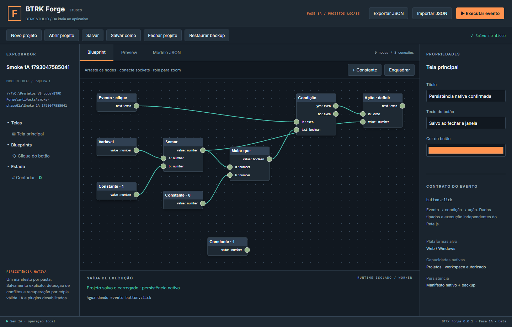

# Validação da Fase 1A

Data: 26/10/2026, America/Sao_Paulo. Plataforma efetivamente testada: Windows x64 do ambiente, volume local NTFS e WebView2. Estado: implementação candidata à revisão; não equivale a aprovação ou teste de durabilidade física.

## Resultado dos checks

| Check | Resultado | Reproduzir |
|---|---|---|
| TypeScript | Aprovado | `npm run typecheck` |
| ESLint | Aprovado | `npm run lint` |
| Domínio/documento/helper | 24 testes aprovados | `npm test` |
| Persistência Rust | 19 casos aprovados | `npm run test:persistence` |
| Host Tauri | 1 caso aprovado | `cargo test --manifest-path apps/studio/src-tauri/Cargo.toml --locked` |
| Regressões do editor | 4 testes aprovados | `npm run test:e2e` |
| Interface + disco Rust | 5 testes aprovados | `npm run test:native` |
| Produção web | 2 testes aprovados | `npm run test:production` após build/export |
| Cargo check | Aprovado na biblioteca e host | `cargo check --manifest-path <módulo>/Cargo.toml --locked` |
| Cargo fmt | Aprovado na biblioteca e host | `cargo fmt --manifest-path <módulo>/Cargo.toml -- --check` |
| Studio Windows | Executável e NSIS gerados | `npm run desktop:build` |
| Exportação web/Windows | Executável/NSIS do exemplo e bundle web gerados | `npm run export:windows` |
| npm audit | Zero alertas reportados | `npm audit --json` |
| Segredos/permissões | Sem achados no scanner restrito | `npm run check:security` |
| Smoke nativo | Criar, editar, salvar, reabrir, fechar com aviso e recuperar em novo processo | Procedimento abaixo; seletores assistidos pelo usuário |

Biblioteca: `packages/native-persistence`; host: `apps/studio/src-tauri`. As saídas locais de testes são `artifacts/unit-results.json`, `e2e-results.json`, `native-e2e-results.json`, `production-results.json`, `native-smoke-result.json` e `phase01a-npm-audit.json`. Evidências portáveis: [resumo](evidence-01a/RESUMO.json).

## Cobertura Rust — filesystem real

Criar, salvar, abrir, salvar novamente e salvar cópia; conteúdo/IDs/grafo preservados; destino existente recusado; inexistência, JSON corrompido, versão futura de schema/documento, referências incorretas e identidade alterada recusados; readonly real; ACL negando escrita em pasta de teste e restaurada ao final; conflito externo por edição/exclusão mantendo os bytes; backup da versão anterior válida; recuperação explícita sem promover corrupção; backup alterado recusado; Unicode; traversal, caminho relativo, extensão e nomes Windows inválidos; lock entre instâncias; renomeação do workspace bloqueada; junction e hard link reais recusados.

Uma injeção altera o arquivo precisamente entre a comparação final e a troca, provando a detecção pós-troca e preservação dos bytes deslocados. Nesse caso o principal pode já ter sido substituído; o teste não comprova compare-and-swap e o serviço não retorna sucesso silencioso. Esse limite permanece explícito na arquitetura.

Outras injeções interrompem após write, sync, antes da troca, após a troca e antes da promoção de backup; cada etapa mantém uma versão antiga ou uma nova versão completa, com backup íntegro. Outro caso recupera um manifesto ausente a partir de temporário sincronizado. Falha comum antes da troca remove somente o temporário da chamada e preserva arquivo alheio de controle. **Essas são falhas controladas em software, não testes de corte de energia nem defeito físico de disco.**

## Interface e regressão

Os cinco testes de projetos executam a biblioteca Rust real por driver isolado; o browser não escreve diretamente os arquivos de projeto. O driver recebe raiz de teste e não é distribuído/registrado no Studio. Testes cobrem: criar e nomear, editar Blueprint/propriedade, dirty, salvar, fechar e reabrir com IDs; cancelar descarte e Salvar e continuar; conflito com disco/memória preservados e cópia segura; corrupção e confirmação obrigatória de backup; nome reservado com erro português e execução transitória sem alterar documento.

Os quatro testes originais de UI, os testes originais de domínio/helper e os dois testes de produção permanecem aprovados. O teste de equivalência do JSON Schema evita desvio estrutural entre Zod e o arquivo consumido pelo backend; regras semânticas Rust e TypeScript ainda exigem manutenção conjunta e seus testes específicos.

## Smoke Windows real e participação do usuário

1. Abrir executável do Studio, sem projeto ativo; clicar Novo, informar nome e escolher pasta no seletor nativo.
2. Verificar manifesto criado, ID e schema; alterar título e criar constante; salvar.
3. Conferir em disco 9 nodes, conexões/IDs preservados e backup; fechar projeto e abrir o manifesto.
4. Editar texto do botão; solicitar fechamento real da janela (Alt+F4); verificar aviso e usar Salvar e continuar.
5. Confirmar que o processo encerrou e o texto foi gravado. Abrir nova instância, selecionar o manifesto e verificar texto, título e 9 nodes; encerrar a instância limpa.

O fluxo foi executado no WebView2 do pacote Windows. Pelo erro de cache/geometria do controle nativo, o usuário selecionou pasta e manifesto nos diálogos; automação Playwright ligada ao próprio WebView conferiu as ações e arquivos. Perfil e porta de depuração foram temporários, somente no processo do teste. Nenhuma configuração permanente de depuração entrou no código ou na distribuição.

A evidência `native-smoke-result.json` registrou `created`, `saved`, `reopened`, `nativeCloseSaved` e `reopenedAfterProcessExit` como true e nodeCount 9. A captura abaixo é do conteúdo do WebView nativo, não de um navegador externo. Ajustes finais de validação/escopo do serviço foram cobertos pelos testes Rust e build final; não foram confundidos com a interação inicial interrompida.

## Fora da validação / riscos que permanecem

- Queda de energia, falha física de disco, controlador/cache defeituoso e filesystem corrompido.
- Matriz FAT/exFAT/ReFS/USB, rede (recusada pela política), caminhos longos e todos os níveis de DPI.
- Instalação/desinstalação em máquina limpa, Authenticode e atualização/rollback assinados.
- Auditoria RustSec, pentest/SAST completo e adversário com a mesma autoridade local ou administrativa.
- Sandbox de builds/código arbitrário, plugins e exportação generalizada.
- Seleção cronológica garantida entre vários snapshots órfãos e retenção automática.
- Ausência absoluta de janela de corrida com editores externos não cooperativos.

O aviso de bundle grande do Monaco permanece. O scanner de segredos é baseado em padrões e não é uma prova absoluta de ausência de credenciais. Projetos de teste, perfis, logs, drivers compilados, instaladores e caches não são publicados no Git; somente código, contratos, fixtures e evidências sanitizadas.
