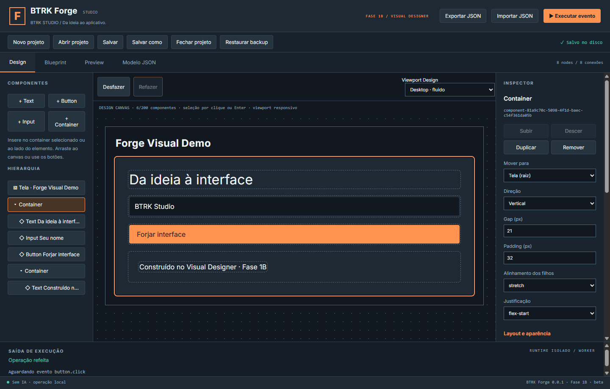
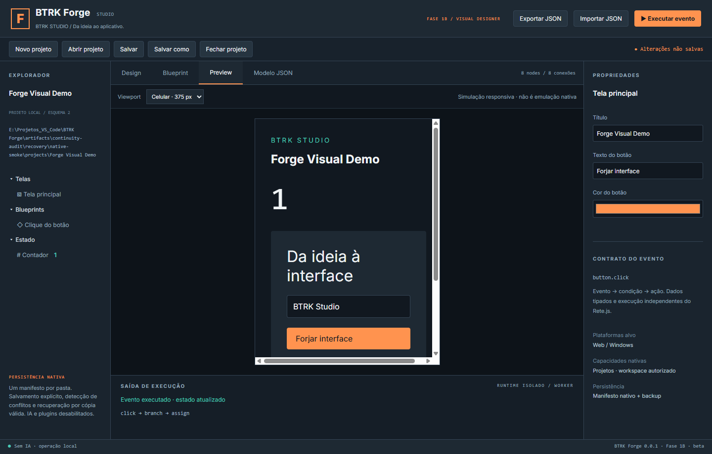

# Validação da Fase 1B

Data: 26/10/2026, America/Sao_Paulo. Windows x64 build 26200.9711, Node 24.16.0/npm 12.0.2, Rust/Cargo 1.99.1 MSVC, Build Tools 2022 17.14.37824.6, MSVC v143, SDK 26100 e WebView2 155.0.4283.62. Resultados obtidos nesta máquina, sem inferir aprovação a partir da documentação da Fase 1A.

## Matriz executada

| Comando | Resultado final |
|---|---|
| `npm run typecheck` | Aprovado |
| `npm run lint` | Aprovado |
| `npm test` | 33 aprovados |
| `npm run test:persistence` | 23 Rust aprovados |
| `cargo test --manifest-path apps/studio/src-tauri/Cargo.toml --locked` | 1 aprovado |
| `npm run test:e2e` | 8 aprovados |
| `npm run test:native` | 8 aprovados |
| `npm run test:production` | 2 aprovados |
| `cargo check --manifest-path <biblioteca ou Studio>/Cargo.toml --locked` | Aprovado nos dois |
| `cargo fmt --manifest-path <biblioteca ou Studio>/Cargo.toml -- --check` | Aprovado nos dois |
| `npm run build` | Aprovado, também executado pelo beforeBuildCommand do Tauri |
| `npm run export:web` | Aprovado, exemplo controlado |
| `npm run desktop:build` | Executável Studio x64 e NSIS gerados |
| `npm run check:security` | Sem achados nos padrões conhecidos e ACL estática |
| `npm audit --json` | Zero vulnerabilidades reportadas |
| Smoke Windows release | Criar/editar/salvar/encerrar/reabrir e Preview confirmados |

**Total automatizado: 75 aprovados, zero reprovados, zero ignorados.** Falhas intermediárias de desenvolvimento estão descritas no relatório, sem serem ocultadas ou somadas ao total aprovado final.

## Cobertura e regressões

- Domínio Designer: criação dos quatro tipos, IDs únicos globais, propriedades/estilos/eventos inválidos, ordenação e mudança de pai, duplicação com remapeamento, remoção de subárvore mantendo Blueprint, ciclos/pais inválidos, 200 componentes/12 níveis, undo/redo e limite de 100 operações.
- Schema: fixture v0/v1 preservada, migração em cópia, fixture atual v2, rejeição de futuro/campos desconhecidos, equivalência do JSON Schema e fonte gerada do renderizador.
- Rust real: igualdade com migração TypeScript, arquivo legado sem escrita ao abrir, backup com bytes antigos após salvar, limites e referências visuais, round trip/cópia dos quatro tipos. As 19 regressões de persistência anteriores continuaram aprovadas, inclusive conflitos, recuperação, locks, ACL, junction/hard link e falhas de gravação injetadas.
- UI web: construir interface sem JSON, Inspector, hierarquia, seleção direta, mover/duplicar/remover, undo/redo e atalhos, inserção por arraste, rejeição de ciclo, Enter/Delete/Escape, disabled e texto semelhante a HTML renderizado literalmente.
- UI + Rust: árvore v2 persistida/reaberta, migração v1 sem escrita automática e backup antigo, histórico preservado após recibo Rust; cinco fluxos anteriores de criação/conflito/recuperação/fechamento continuam aprovados. Ctrl+S foi usado no fluxo de Design.
- Regressão web/produção: Rete, nodes, conexões, arraste/zoom, importação/exportação JSON, rascunho corrompido, CSP/iframe/Worker/Monaco, isolamento e execução do exemplo exportado.

Os native-e2e usam Chromium com armazenamento Rust real e seletores substituídos por diretórios de teste. Eles não são apresentados como observação da janela Tauri. Os testes de produção usam arquivos dist e servidor estático, sem Vite.

## Homologação Windows real — Forge Visual Demo

1. Executável release aberto; título e processo BTRK Forge — BTRK Studio confirmados pelo controle de janelas Windows.
2. Novo projeto Forge Visual Demo criado em área temporária. O seletor retornou a pasta de testes da auditoria anterior; o caminho foi conferido antes da edição e não continha projeto real a sobrescrever.
3. Pelo Design, sem JSON: Container principal com padding/gap, Text de título com fonte 32, Input inicial BTRK Studio, Button Forjar interface ligado a click e segundo Container horizontal com Text. Remoção explícita do botão legado preservou o grafo. Subir/Descer, duplicação, remoção e undo/redo foram exercitados.
4. Preview exibiu a hierarquia, valor inicial e os textos. O botão executou o contador 0→1; viewport móvel foi observado. Salvar escreveu seis componentes no manifesto, mantendo 8 nodes/8 conexões e a identidade.
5. Processo encerrado; nova instância do executável final aberta com perfil separado. O manifesto foi aberto no seletor real, e o documento completo conferiu com o salvo antes de qualquer edição adicional.
6. Mesmos IDs, hierarquia, propriedades, valores iniciais e grafo foram confirmados. Preview renderizou novamente e o botão repetiu o contador 0→1.
7. Teste adicional na instância final: gap 20→21, Salvar, Desfazer e Refazer. O histórico permaneceu disponível e redo voltou ao estado Salvo no disco. Processo final encerrado limpo.

ID do projeto: `project-7e1ae24e-0eca-4f63-ab5e-ec92059dc542`. Duas seleções nativas assistidas pelo usuário; demais ações e verificações no WebView2 e no disco foram automatizadas. Portas/perfis de depuração locais existiram apenas nos processos de teste. Nenhuma configuração permanente de depuração foi acrescentada.

Os listeners de pageerror não capturaram erros nos intervalos instrumentados. As screenshots registram conteúdo do WebView nativo; não são capturas de Chromium externo. Não foi executado comparador pixel a pixel entre instâncias: a conferência foi por documento completo, elementos renderizados, propriedades e resultado do evento. Seleção/viewport/histórico são efêmeros por contrato.

## Artefatos e rastreabilidade

O [resumo versionado](evidence-01b/RESUMO.json) registra commit de implementação, base main, contagens, smoke e SHA-256 dos builds locais. Saídas geradas: `apps/studio/src-tauri/target/release/btrk-forge.exe` e `target/release/bundle/nsis/BTRK Forge_0.0.1_x64-setup.exe`.

No clone validado, `artifacts/phase01b/` contém logs das suítes, checks/builds, auditoria npm, hashes e `native-smoke/result.json`, screenshots e snapshot do documento salvo. Relatórios JSON das suítes também são gerados em `artifacts/unit-results.json`, `e2e-results.json`, `native-e2e-results.json` e `production-results.json`. Projetos/perfis/instaladores não são versionados.

## Não executado e ressalvas abertas

- Corte físico de energia, disco cheio real, controladora/filesystem defeituoso e matriz de volumes/DPI.
- Eliminação da janela residual de corrida entre hash e troca; o teste existente confirma detecção/preservação, não CAS de kernel.
- RustSec/cargo-audit, pentest/SAST completo e revisão exaustiva de todas as crates.
- Instalação/desinstalação em máquina limpa, assinatura comercial e atualizações/rollback.
- Correção da mensagem histórica WebView2 no encerramento. O smoke não monitorou todo stderr do release e não a considera resolvida.
- Build Windows do contador exportado da Fase 0; somente sua exportação web foi repetida. Exportação geral do Designer não existe nesta fase.
- Conformidade completa de acessibilidade, performance de grandes documentos, todos os gestos/dispositivos e suporte a outros sistemas operacionais.

**GO COM RESSALVAS**, candidata à revisão. A main deve permanecer intacta e a Fase 1C não foi iniciada.
