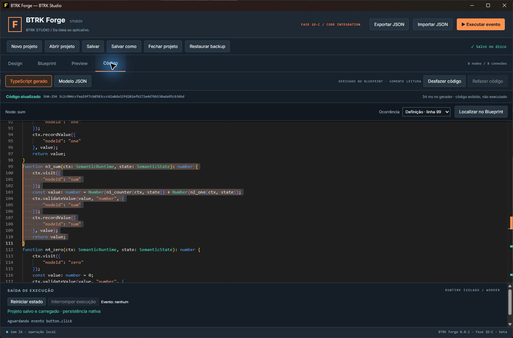
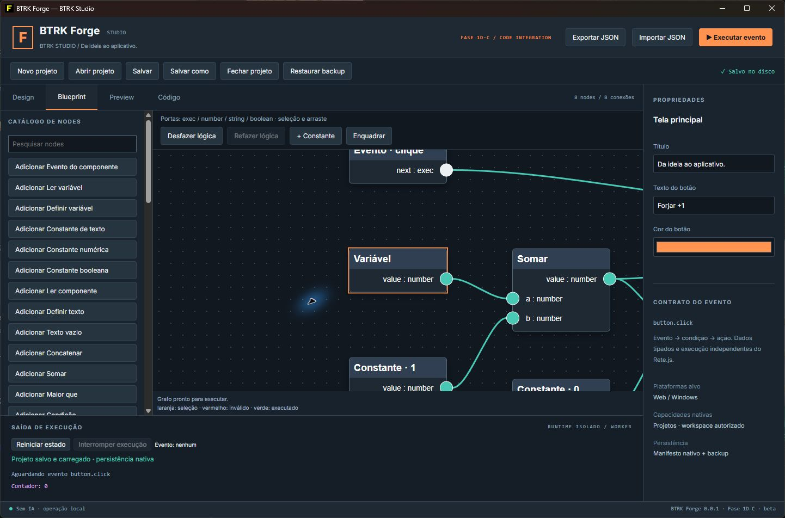
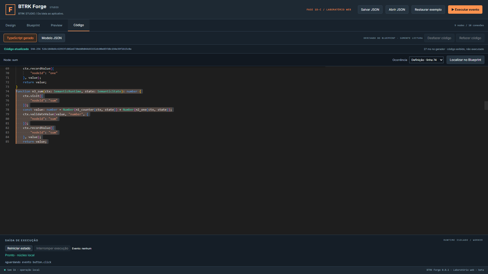
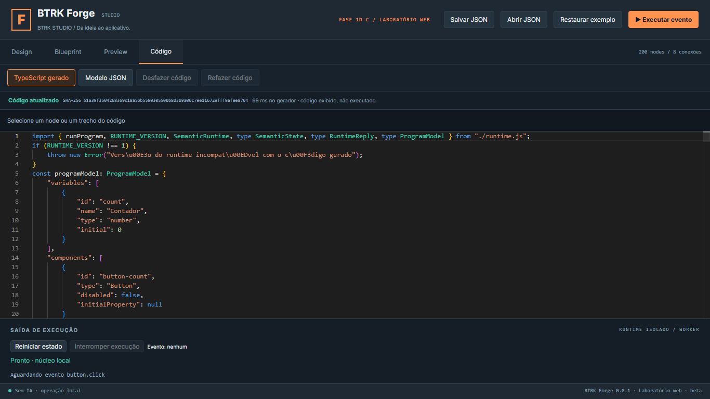
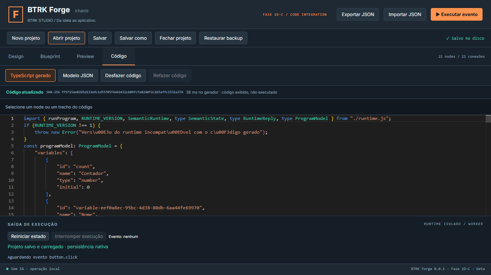
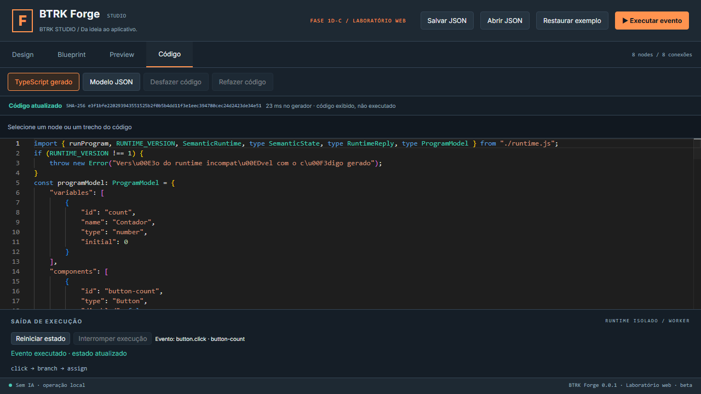

# Validação — Fase 1D-C

Execução em Windows, iniciada em 27/10/2026. Base `78b856fad0ff556aa205481f7dd46c239bbf8e8a`; branch `codex/phase-01d-c-monaco-integration`. Candidata à revisão, sem encerramento ou integração à main. [Relatório](../phases/RELATORIO_FASE_01D_C.md) e [arquitetura](../MONACO_CODE_INTEGRATION.md).

## Resultados finais

| Comando/suíte | Resultado |
|---|---|
| npm run typecheck / npm run lint | aprovados |
| npm test | 122 aprovados, 10 arquivos, inclui diferenciais 1D-B e 15 novos de navegação/cliente |
| npm run test:persistence | 26 aprovados |
| cargo test --manifest-path apps/studio/src-tauri/Cargo.toml --locked | 1 aprovado |
| npm run test:e2e | 20 aprovados, incluindo 6 novos |
| npm run test:native | 10 aprovados, incluindo Code Demo; UI Chromium + serviço Rust real |
| npm run test:production | 4 aprovados, incluindo geração com CSP de produção |
| cargo check --locked / cargo fmt -- --check, persistência e host | aprovados |
| npm run build / npm run export:web | aprovados |
| npm run desktop:build (target isolado em artifacts) | executável e instalador NSIS gerados; não instalado |
| npm run check:security | zero ocorrências nos padrões conhecidos |
| npm audit --json | zero vulnerabilidades reportadas |
| git fsck --full / git diff --check | sem corrupção/erros de whitespace; objetos dangling benignos reportados pelo fsck |

**Total: 183 aprovados, 0 reprovados finais, 0 ignorados.** Builds e verificações não são contados como testes. Repetição isolada de navegação 3/3 aprovada, sem aumentar o total. Logs locais ficam em `artifacts/phase01d-c-20261027`; resumo e hashes versionados em [verification.json](evidencias/fase01d-c/verification.json). Auditoria RustSec não foi realizada e permanece pendente.

## Cobertura e limites da prova

Os testes puros verificam intervalos UTF-16, fronteiras, desempate, auxiliares, ordenação definição/chamadas, versões/coordenadas, lazy/cache, troca de documento/sessão, resultados atrasados, timeout, erro e retry. O E2E usa Monaco real, tentativa de edição proibida, busca e seleção de chamada, canvas enquadrado, parâmetro/undo/redo, desconexão, node incompleto, adição/remoção, JSON válido/inválido e preservação de buffer. O teste de falha injeta erro no Worker e verifica recuperação após retry.

O Forge Code Demo UI/Rust monta 21 nodes/conexões e componentes pela UI, testa vazio e Ana, salva/reabre pelo driver Rust, protege rascunho JSON e troca para segundo projeto. Fixtures JSON são usadas em cenários automatizados específicos de domínio; não são apresentadas como construção manual do Demo. Produção usa servidor estático, CSP real, geração same-origin e Preview declarativo preservado.

No ensaio de 200 nodes a medição browser registrou 33 heartbeats, intervalo máximo de aproximadamente 268,7 ms e duração total de aproximadamente 960,1 ms, incluindo carregamentos iniciais. Não é garantia universal de latência; tempo interno do gerador é medido separadamente. Worker compiler aproximadamente 3,67 MB antes de compressão, carregado sob demanda. Screenshot 1366×768 e Full HD verificadas visualmente.

## Evidência Windows real — homologação parcial

O novo executável Tauri desta execução abriu no WebView2. O usuário selecionou a pasta de destino devido à falha do controlador no diálogo nativo: “element is not available in cached app state”. Criou-se Forge Code Demo; Input e Text foram adicionados pelo Design ao exemplo e salvos. O grafo de 8 nodes/8 conexões foi aberto no Código, com SHA e definição `sum`; clicar na chamada `counter` selecionou essa origem e Localizar enquadrou o node no Blueprint, mantendo ✓ Salvo no disco. Não se declara teste completo manual de readonly, binding/Preview, undo/redo, fechamento/reabertura de processo ou instalação limpa nesta rodada.

## Evidências automatizadas — identificadas separadamente

## Falhas intermediárias e riscos restantes

As primeiras execuções revelaram incompatibilidade ES2023/readonly, corrida de seleção inicial, suposições antigas sobre DOM/Find do Monaco, digitação JSON com autoindentação e tentativa de consultar Worker encerrado. Foram corrigidas e as suítes finais passaram. Logs intermediários locais foram preservados, sem classificar essas tentativas como aprovadas. Não há novo ajuste em Rust, schema, execução declarativa ou permissões.

Continuam abertas as cinco ressalvas: durabilidade sob falta de energia, corrida externa sem CAS de kernel, RustSec, instalação/desinstalação limpa e mensagem histórica WebView2 no encerramento. Mantidos também harness sem sandbox de SO, corpus finito, dependência do runtime companheiro, revisão CommonJS antes de TS7, ausência de edição bidirecional e exportação generalizada. O diagnóstico avançado da 1D-D não começou. Recomendação: **GO COM RESSALVAS para revisão**, com homologação manual integral ainda pendente.
