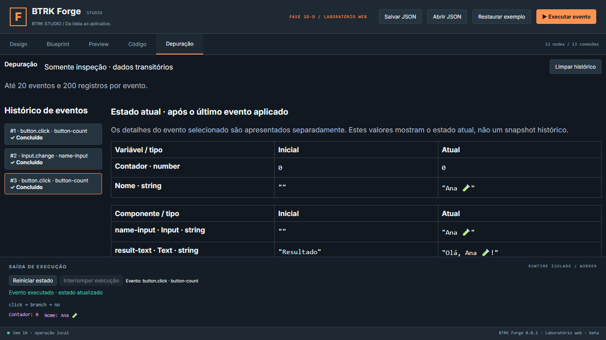
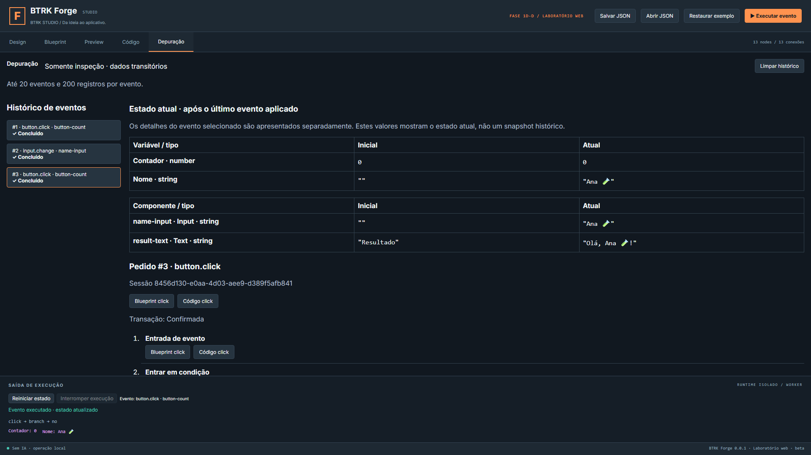
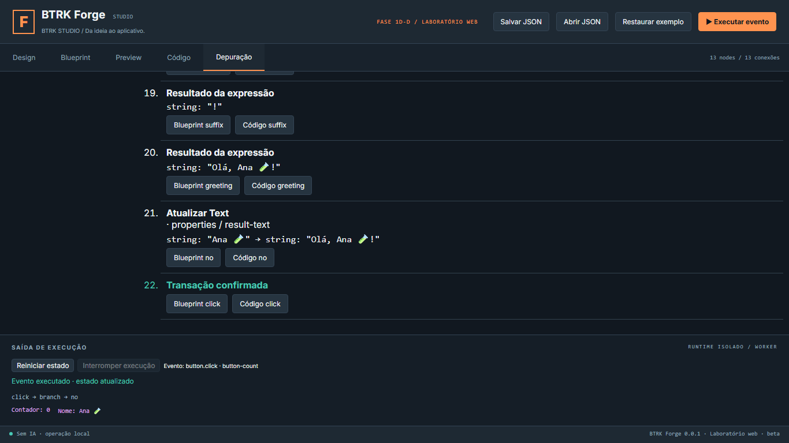
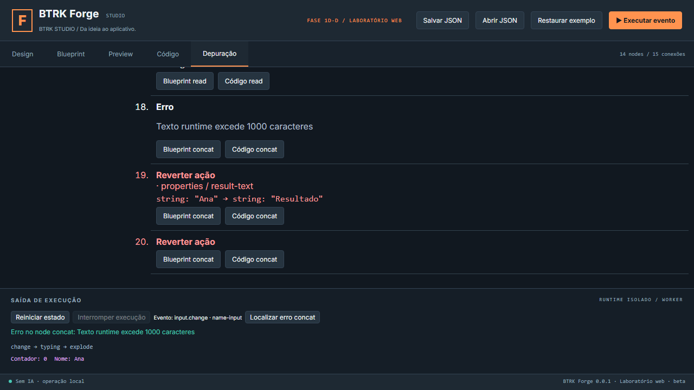
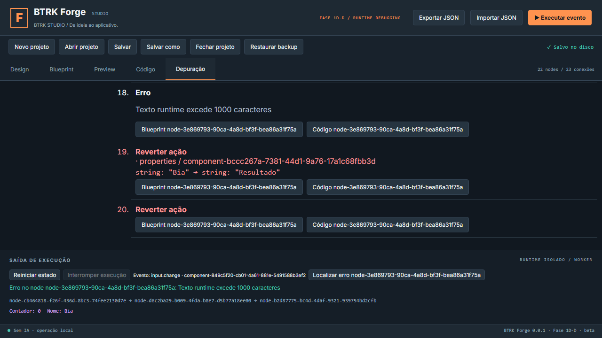
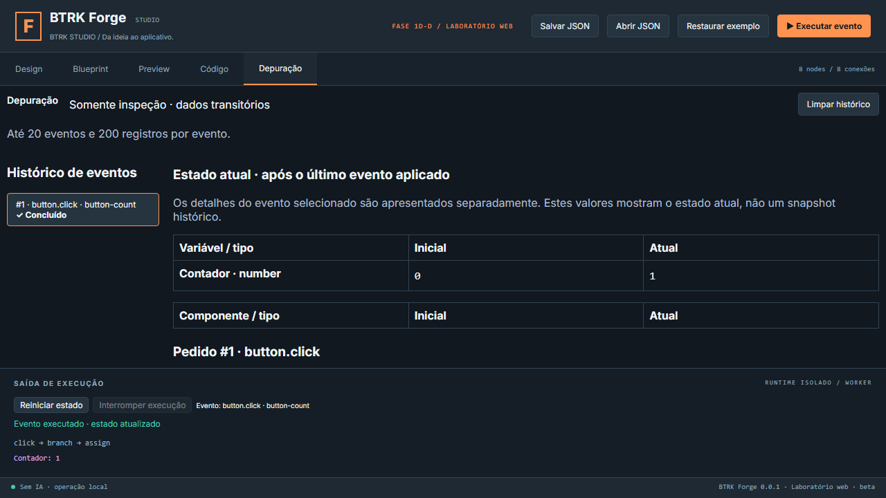

# QA — Fase 1D-D

Data: 27/10/2026, America/Sao_Paulo. Base `36b3458bf04205d818dbc3e7aa13396a85be476b`; branch `codex/phase-01d-d-debugging-validation`. Candidata à revisão, sem integração à main. [Relatório](../phases/RELATORIO_FASE_01D_D.md) e [contrato](../RUNTIME_DEBUGGING.md).

Ambiente: Node v24.11.1, npm 11.6.2, Rust/Cargo 1.99.0, Windows/MSVC e WebView2 disponíveis no build/abertura observados.

## Suítes efetivamente executadas

| Suíte | Aprovados | Falhas finais | Ignorados |
|---|---:|---:|---:|
| npm test — domínio, IR, codegen, diferenciais, navegação e debug | 136 | 0 | 0 |
| Rust persistência — cargo test --lib --locked | 26 | 0 | 0 |
| Rust host — cargo test --locked | 1 | 0 | 0 |
| npm run test:e2e | 25 | 0 | 0 |
| npm run test:native — UI Chromium + driver Rust | 11 | 0 | 0 |
| npm run test:production — CSP e exportador histórico | 5 | 0 | 0 |
| **Total** | **204** | **0** | **0** |

Sem somar asserts, fixtures, eventos, builds ou repetições como testes únicos. Suíte específica inicial de depuração/coordenação repetida 7/7 passou antes da regressão completa; não aumenta o total.

Também aprovados: npm run typecheck, npm run lint, cargo check --locked e cargo fmt -- --check para `packages/native-persistence` e `apps/studio/src-tauri`, npm run build (também executado pelo desktop:build), npm run export:web, npm run desktop:build com target isolado, npm run check:security e npm audit. Audit reporta zero vulnerabilidades npm; scanner reporta zero ocorrências de padrões conhecidos. Isso não substitui auditoria RustSec. Avisos de chunks grandes e NO_COLOR/FORCE_COLOR não bloqueiam a compilação.

Logs locais preservados em `artifacts/phase01d-d-20261027`: unit-final.log, typecheck.log, lint.log, e2e.log, native-final.log, production.log, rust-*-test/check/fmt.log, desktop-build-text-final.log, export-web.log, security.log, npm-audit.json e git-fsck.log. Build Windows usa `windows-target/release/btrk-forge.exe` e NSIS em `windows-target/release/bundle/nsis`. Instalador não foi executado. Hashes e resumo estão em [verification.json](evidencias/fase01d-d/verification.json).

## Cenários e evidências automatizadas

- Ordem independente exata, múltiplas avaliações de sum/counter, leitura após escrita, ramos executados e actions before/after.
- Ingestão Input antes de ações, leitura de propriedade, binding, confirmação e rollback com valor anterior restaurado e nome ingerido preservado.
- Falhas com node e globais; evento incompatível e documento incompleto; limites de tamanho/cardinalidade, orçamento real excedido com trace truncado e resposta original intacta.
- Tipos, Unicode de 1000 unidades, -0, valores finitos, versão/sessão/ordem inválida e campos extras recusados.
- Histórico cronológico limitado/limpável, interrupção/timeout sem detalhes inventados, FIFO, reply antigo, troca de documento, fechamento/reabertura e outro projeto.
- Navegação para canvas e TypeScript com mapa atual, sem dirty/undo e sem persistir runtime/trace. Produção executa Worker real sob CSP e mantém Preview isolado.

Screenshots verificadas visualmente; as áreas internas são roláveis. Capturas automatizadas não são apresentadas como janela Windows nativa.

## Homologação Windows real — lacuna aberta

O executável novo da 1D-D foi aberto e observado com a identificação da fase. O seletor nativo falhou no controle por elemento e coordenadas, exigindo auxílio manual. Houve abertura recusada por uso exclusivo de um projeto. Depois, o estado observado na janela foi Forge Code Demo da 1D-C, 8 nodes e 8 conexões; não se confirmou a abertura do Forge Debug Demo de 21 nodes, apesar das respostas de confirmação. Não se infere sucesso do estado de UI não observado.

Portanto, os 12 passos do roteiro completo (ramos vazio/preenchido, onChange, histórico, variáveis, ação→Blueprint→TypeScript, reinício, salvar/fechar/reabrir e conferir IDs/binding/ausência de debug persistido), além do rollback controlado, foram aprovados na UI automatizada com Rust, **mas permanecem pendentes de homologação integral na janela WebView2 real**. A pendência manual da 1D-C continua aberta. A mera abertura do executável não é homologação do Demo, instalação limpa ou distribuição comercial.

Após a regressão geral, foi corrigido apenas o texto que distingue tabela atual dos detalhes históricos. Typecheck/lint, build web/Windows e os cenários de depuração web/UI-Rust/produção foram reconferidos. Capturas de sequência/rollback foram atualizadas para mostrar os valores explicitamente. Essas repetições não aumentam o total de casos únicos.

## Falhas intermediárias preservadas

Expectativa de erro greeting corrigida para concat (a primeira concatenação já excedia 1000 caracteres); init script da fixture limitado ao top frame para não acessar localStorage no iframe sandbox; registro global completado com nodeId null. Primeira execução de UI/Rust durante edições/HMR: 8 aprovados e 3 timeouts, com DOM destacado e aviso de createRoot. Repetição integral com fontes estabilizadas: 11 aprovados. Logs debug-initial.log, debug-second.log e native-initial.log preservam essas tentativas; não foram apagados ou contados como aprovação final.

## Riscos preservados

Durabilidade física sob falta de energia, corrida externa sem CAS de kernel, RustSec, instalação/desinstalação limpa e mensagem histórica WebView2 continuam abertos. Igualmente: homologação Windows integral, harness sem sandbox de SO, corpus finito, runtime companheiro fixo, revisão CommonJS antes de TS7, custo inicial/escala do compilador Worker, exportação geral, edição bidirecional e matriz ampla de DPI/acessibilidade. Trace limitado é um prefixo, não um snapshot completo; cancelamento não recupera trace que não chegou. Não se aprova distribuição comercial. Recomendação: **GO COM RESSALVAS para revisão**, sem encerrar a Fase 1D ou iniciar outra fase.
